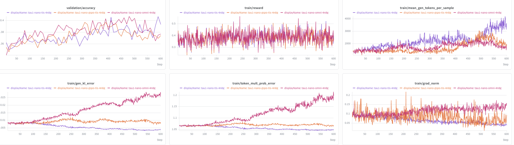

# Conversational Tool Use (Pivot RL) — Experiment Results, Part 2

Follow-up to `exp.md`. All tau2-bench numbers are average reward (x100),
4 trials per task, gpt-5.6-luna user simulator. tau-voice is the half-duplex harness from Part 2 of
`exp.md` (user turns are Chatterbox-Turbo TTS audio, agent listens and
replies in text).

## Part 1: Fixing the train/generation logprob divergence (gen_kl_error)

Model under study: Nemotron-3-Nano-Omni-30B-A3B-Reasoning-BF16, trained with
pivot RL on the public text dataset
(`nvidia/Nemotron-RL-Agentic-Conversational-Tool-Use-Pivot-v1`, 96K rows).

The baseline think-arm run (plain GRPO) shows a monotonic climb of
`train/gen_kl_error` (0.008 → 0.028) and `train/token_mult_prob_error`
(1.07 → 1.20) over 600 steps. Root-caused offline: the RL-sharpened
mamba-hybrid weights become numerically fragile at specific high-frequency
punctuation tokens — three independent implementations (vLLM inference,
Megatron training forward, HF eager) mutually disagree by up to e^10 at those
positions, and fp32 does not reconcile them. No single engine is buggy; the
mismatch is a property of how far the weights drift off the pretrained
manifold, and the uncorrected gradient feeds back into more drift.

Figure: baseline think arm (pink) vs the fixed run (gray). Validation
accuracy and train reward are unaffected, while `gen_kl_error`,
`token_mult_prob_error`, and `grad_norm` stay flat for the fixed run
(gen_kl_error ~0.009 at step 600 vs 0.028; token_mult_prob_error 1.07 vs 1.20).

YAML changes relative to the baseline think arm (`loss_fn` unless noted):

| Setting | baseline | fixed run | role |
|---|---|---|---|
| `use_importance_sampling_correction` | false | **true** | token-level weight π_train/π_gen ≈ 0 at fragile tokens (train≪gen) — silences their gradient; the main driver of the fix |
| `truncated_importance_sampling_type` / `ratio` | null | **tis / 5.0** | caps exploding weights in the opposite direction (train≫gen) |
| `grpo.seq_logprob_error_threshold` | 2 (never fires) | **1.5** | masks whole pathological sequences (fires 1–3 per 1024 late in training) |
| `sequence_level_importance_ratios` + `token_level_loss` | false / true | **true / false** | GSPO: sequence-level ratio dilutes single-token spikes out of the clip decision |
| `ratio_clip_max` | 0.2 | 0.28 | decoupled clip, per the official omni recipes |

### Table 1: tau2-bench, text (luna user sim)

Full checkpoint curves for the GSPO+TIS arm and the TIS-only ablation arm
(token-level GRPO + full TIS protective stack, same data) were batch-decoded
2026-09-12..15. telecom = mean of the two 57-task halves. Best checkpoint of
each experiment in **bold**.

| Model | airline | retail | telecom | avg |
|---|---|---|---|---|
| Nemotron-3-Nano-Omni (no training) | 58.50 | 64.25 | 44.96 | 55.90 |
| + Pivot RL, plain GRPO (step 470) | 61.31 | 60.09 | 50.44 | **57.28** |
| GSPO+TIS, step 110 | 58.50 | 62.28 | 43.65 | 54.81 |
| GSPO+TIS, step 160 | 57.00 | 63.82 | 46.05 | 55.62 |
| GSPO+TIS, step 200 | 55.78 | 59.21 | 45.62 | 53.54 |
| GSPO+TIS, step 300 | 56.50 | 66.89 | 36.19 | 53.19 |
| GSPO+TIS, step 350 | 56.28 | 65.35 | 34.87 | 52.17 |
| **GSPO+TIS, step 420** | 60.80 | 62.72 | 46.08 | **56.53** |
| GSPO+TIS, step 570 | 55.56 | 64.40 | 29.61 | 49.86 |
| GSPO+TIS, step 600 | 56.50 | 56.58 | 31.36 | 48.15 |
| TIS-only, step 110 | 57.73 | 64.91 | 43.54 | 55.39 |
| TIS-only, step 200 | 57.07 | 68.20 | 37.01 | 54.09 |
| TIS-only, step 260 | 64.62 | 64.91 | 40.45 | 56.66 |
| TIS-only, step 290 | 61.03 | 68.42 | 35.37 | 54.94 |
| TIS-only, step 300 | 63.59 | 65.35 | 37.30 | 55.41 |
| TIS-only, step 350 | 62.60 | 67.76 | 42.73 | 57.70 |
| TIS-only, step 410 | 63.49 | 71.71 | 41.53 | 58.91 |
| TIS-only, step 460 | 63.92 | 71.05 | 42.08 | 59.02 |
| TIS-only, step 470 | 65.31 | 68.64 | 36.79 | 56.91 |
| **TIS-only, step 600** | **68.45** | **74.34** | **48.69** | **63.83** |

Takeaways: the GSPO arm is single-peaked at step 420 and degrades hard
afterwards (telecom 46.1 → 29.6/31.4; the tool-calling bias below compounds
with training). The TIS-only arm, previously believed to peak at 410 from a
3-point screen, in fact climbs monotonically through 600: airline
63.5→68.5, retail 71.7→74.3, and telecom t1 hits 72.6 at step 600 — the
best t1 of any arm. **tis step 600 = 63.83 is the overall record** (+7.9
over base, +4.9 over the previous champion tis_410); training stopped at
600 only because of the step budget, so the curve may not have peaked.

### Table 2: tau-voice, half-duplex speech input

airline: base and step 470 are 4 trials (200 sims); GSPO step 420 is 1 trial
(±7 noise at 1σ). retail / telecom: 1 trial.

| Model | airline | retail | telecom | avg |
|---|---|---|---|---|
| Nemotron-3-Nano-Omni (no training) | 50.26 | 39.82 | 25.93 | 38.67 |
| + Pivot RL, plain GRPO (step 470) | 56.57 | 45.13 | 24.56 | **42.09** |
| + Pivot RL, GSPO+TIS (step 420) | 54.35* | 38.36** | 20.19 | 37.63 |
| + Pivot RL, TIS-only (step 600) | 72.73*** | 46.36 | 25.32*** | **48.14** |

`*` 46/50 scored (4 empty-output runner errors).
`**` only 73/114 scored on this early run (evaluation-harness scoring issue,
since fixed; corrected reruns in exp3.md).
`***` TIS-only step 600 coverage: airline 33/50 scored, retail 110/114,
telecom 79/114 — see Analysis item 2 for the invalid-answer breakdown.

Analysis

1. **GSPO's sequence-level loss has a behavioral side effect.** Per-sequence
   (instead of per-token) weighting upweights short tool-call rows relative
   to long text rows. Downstream this shows up as a tool-calling bias:
   its `mobile_data_issue` score is 58 vs 81 for step 470, with 1.5x the
   hallucinated device-tool calls, and the same talk-less/tool-more shift
   shows up in voice telecom (assistant text-turn ratio 0.65 vs 0.72),
   where the deficit repeats (20.2 vs 24.6).

2. **TIS-only step 600 on tau-voice: strong scores, but a large and growing
   invalid-answer rate.** Unanswered counts: airline 17/50 (34%), retail
   4/114, telecom 35/114 (31%). Every one fails with the same runner error
   (`AssistantMessage must have either content or tool_calls`) — a genuine
   model-side empty output: the model enters a repetition loop over
   structural tokens during the reasoning phase (invented template markers,
   tool-schema tags, policy sentences), either burning the full token budget
   or ending in an early EOS with no final message. The failing set is
   random across task families and personas, and the rate grows
   monotonically with TIS training (airline: base 2-6% → step 410 16% →
   step 600 34%) — consistent with the hypothesis that the TIS weights
   silence gradients at fragile structural tokens and with them the
   "don't repeat" learning signal. On the scored sets the gains are real,
   not a survivor-selection artifact: paired on common scored tasks vs step
   410, airline +13.8, retail +1.4, telecom +3.2 — all three domains
   improve. Net: step 600 is the strongest checkpoint but the least
   reliable; serving needs retry-on-empty / repetition_penalty, and the
   ratio_min-floor arm (clamping TIS weights to [0.1, 5.0]) is the candidate
   root fix under evaluation.

---

## Part 2: Difficulty-filtered data (self-profiled subsets & the paper's d60 set)

### Data provenance (who profiled what)

All difficulty filters share the same rule (keep rows with profile score
0 ≤ reward_mean ≤ 0.6) but differ in the *profiling model*, which turns out
to matter enormously (difficulty does not transfer across models):

| Dataset | source pool | profiling model | rows |
|---|---|---|---|
| public HF 96K set (our default training data) | 1.4M raw pivot pool | **Super3** (Nemotron-Super) profile, 0 ≤ score ≤ 0.6 | 96,456 |
| d60 (`train_difficulty_60`, the Pivot-RL paper's training set) | 1.4M raw pivot pool | **Qwen3-think** self-profile (16 rollouts), 0 ≤ score ≤ 0.6 | 314,565 |
| subsets A/B below | the public HF 96K set, filtered FURTHER | **nano-omni** self-profile (8 rollouts) | 28,538 / 66,522 |

### Data: nano-omni self-rollout profiling

We re-profiled the public 96K pivot set with the model itself: 8 rollouts per
prompt with Nemotron-3-Nano-Omni, scored by the same single-step verifier,
giving each row a difficulty score reward_mean ∈ {0, 1/8, …, 1}. Two training
subsets were built from this profile:

| Filter stage | rows |
|---|---|
| source (public pivot set, self-profiled) | 96,456 |
| dropped: reward_mean > 0.6 (5–8 of 8 correct) | 29,934 |
| all-zero rows (0/8 correct) | 37,984 |
| mixed rows (1–4 of 8 correct) | 28,538 |
| **subset A "mixed-only": 0 < reward_mean ≤ 0.6, all-zero EXCLUDED** | **28,538** |
| **subset B "keep-all-zero": reward_mean ≤ 0.6, all-zero INCLUDED** | **66,522** |

Subset A keeps only rows with a live learning signal today (the model
sometimes solves them); subset B additionally keeps the all-zero rows as
curriculum reserve, mirroring the paper's internal training set (44.7%
all-zero).

### Arm A: plain GRPO on subset A (mixed-only, no all-zero rows)

Same plain-GRPO recipe as the `exp.md` Part 2 baseline; only the data
changes. Trained 231 steps; validation peaked at step 160 with roughly 2x
the sample efficiency of the full-data arm, then plateaued (the static
difficulty profile goes stale as the policy improves).

### Arm B: DAPO on subset B (all-zero rows kept)

On top of the full Part-1 stack (GSPO + TIS + seq threshold), we enable DAPO
dynamic sampling so the 57% all-zero rows do not waste optimization steps
while unsolved: each step oversamples 2x prompts
(`grpo.use_dynamic_sampling: true`, `batch_multiplier: 2.0`), discards
zero-variance rollout groups, and trains on the first 64 groups with reward
variance. Trained 598 steps.

### Table 3: decode results (same protocols as Tables 1–2)

tau2-bench, text (luna user sim):

| Model | airline | retail | telecom | avg |
|---|---|---|---|---|
| Nemotron-3-Nano-Omni (no training) | 58.50 | 64.25 | 44.96 | 55.90 |
| + A: plain GRPO, mixed-only (step 160) | 51.02 | 62.94 | 41.23 | 51.73 |
| + A: plain GRPO, mixed-only (step 210) | 57.84 | 68.42 | 27.90 | 51.39 |
| + B: DAPO, all-zero kept (step 390) | 28.27 | 17.54 | 15.79 | 20.53 |
| + B: DAPO, all-zero kept (step 440) | 16.33 | 13.16 | 14.91 | 14.80 |

tau-voice, airline (1 trial): B step 390 = 19.15 (47/50 scored), B step 440 =
12.00 (50/50). Arm A was not evaluated on voice.

### Analysis

- **Arm A (mixed-only, plain GRPO) is mildly net negative** (51.7 / 51.4 vs
  base 55.9) despite the cleanest training curves of any arm: the two
  checkpoints fail in complementary ways (step 160 keeps telecom but loses
  airline; step 210 recovers airline/retail but telecom collapses to 27.9).
  Self-profiled difficulty selection speeds up validation progress but does
  not transfer.
- **Arm B (all-zero kept, DAPO) collapses outright** and keeps degrading
  with training. Trajectory inspection: 88–94% of simulations contain
  identically repeated failing tool calls (vs 6% for arm A and 22% for
  GSPO), sloppy-argument errors are 30x other arms, most simulations end via
  the error limit. Mechanism: under dynamic sampling the surviving gradient
  groups from all-zero rows are dominated by "1–2 lucky successes out of
  16", and those rare successes are disproportionately verifier artifacts
  (fuzzy argument matching passes sloppy calls; message actions score 1.0
  for any text). DAPO concentrates the batch on exactly these groups (64% of
  trained groups early on), so the policy imitates verifier-exploiting
  behavior at maximal advantage. The all-zero rows under a lenient
  single-step verifier are the root cause; DAPO is a faithful amplifier —
  and the internal validation set (same lenient verifier) cannot see the
  damage (its curve sat at an unremarkable ~0.35 throughout).

### Arm C: the paper's d60 data (Qwen3-think profile), plain GRPO recipe

Strict replication of the think-baseline recipe (plain GRPO, token-level
loss, no IS correction) with the training data swapped wholesale for the
paper's `train_difficulty_60` (Qwen3-think self-profile — see the provenance
table; 60 rows overlapping our standard 512-row val set removed → 314,505
training rows; val unchanged). Planned 800 steps, stopped at 785 on clear
degradation. Full checkpoint curve batch-decoded 2026-09-12..14 (same
protocol as Table 1; best checkpoint in **bold**):

| Model | airline | retail | telecom | avg |
|---|---|---|---|---|
| Nemotron-3-Nano-Omni (no training) | 58.50 | 64.25 | 44.96 | 55.90 |
| d60, step 200 | 54.17 | 66.96 | 38.00 | 53.04 |
| d60, step 340 | 45.56 | 70.64 | 42.78 | 52.99 |
| d60, step 350 | 51.20 | 69.23 | 46.02 | 55.48 |
| d60, step 380 | 56.20 | 72.61 | (not run) | — |
| d60, step 410 | 52.76 | 73.68 | 40.23 | 55.56 |
| **d60, step 460** | 55.17 | 71.46 | 41.89 | **56.17** |
| d60, step 570 | 52.46 | 70.29 | 38.28 | 53.68 |
| d60, step 590 | 55.25 | 70.51 | 37.47 | 54.41 |
| d60, step 600 | 45.70 | 67.00 | 40.00 | 50.90 |
| d60, step 700 | 46.94 | 65.05 | 37.70 | 49.90 |
| d60, step 780 | 41.49 | 68.57 | (not run) | — |
| d60, step 785 | 39.25 | 67.33 | 33.73 | 46.77 |

Reading the full curve (vs the original 3-point screen at 380/410/600):
retail is a genuine, stable gain (67-74 throughout, peaks 73.7); airline is
NOT a monotonic collapse before step 600 — it oscillates ±5 around 52-56
(dips at 340/600 recover at 380/460) — and only truly falls off a cliff
after 600 (700: 46.9 → 785: 39.3). The best checkpoint d60_460 (56.17)
still never beats base (55.90) on the 3-domain average, so the conclusion
stands: the paper data's domain gains are a rebalancing trade, not a net
win, when swapped in wholesale for nano — but the practical damage window
is later than the first screen suggested.
