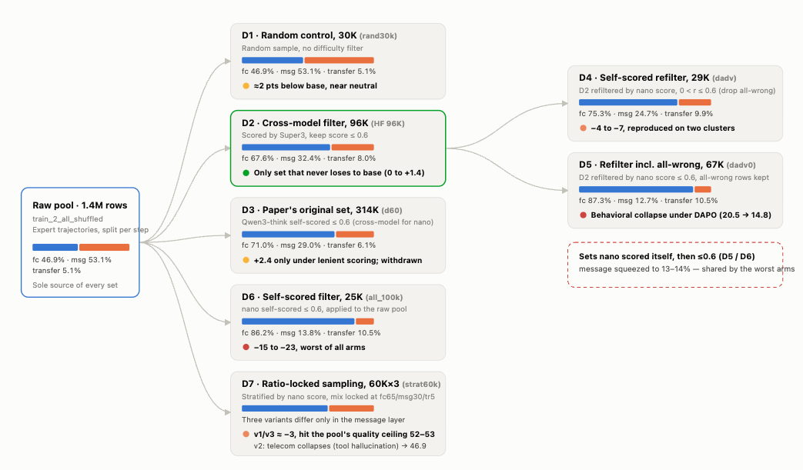
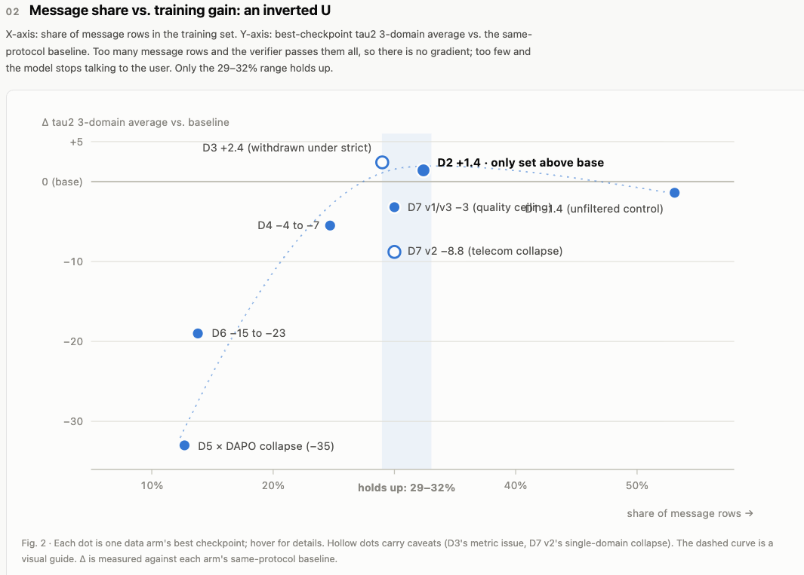

## Part 1: Fixing the empty-output failure mode (chat-template rendering)

### The problem: nano-omni's chat template bug

Wrong redering:
```
# before (upstream template, training-time rendering)
<|im_start|>system
[{'type': 'text', 'text': 'You are a customer service agent that helps the
user according to the <policy> provided below. ...'}]<|im_end|>
```

Tau-bench (empty-output sims / total sims per run):

| ckpt | airline | retail | telecom t1 | telecom t2 |
|---|---|---|---|---|
| base (no training) | 0/200 | 0/456 | 0/199 | 0/198 |
| open HF data, TIS-only step 600 | 13/469 (airline+retail) | | 16/193 (8%) | **34/152 (22%)** |
| internal pivot rl paper data, step 380 | **49/200 (25%)** | 7/456 | 2/190 | 5/153 |

After fix:
```
# after (sysfix template)
<|im_start|>system
You are a customer service agent that helps the user according to the
<policy> provided below. ...<|im_end|>
```

Two arms, identical to the TIS-only arm (same 96K data, same loss stack,
same schedule) except the rendering — plus one knob in arm B:

- **ctpl**: TIS recipe × full data × clean template (single-variable
  counterpart of the TIS-only arm);
- **rmin**: ctpl + `truncated_importance_sampling_ratio_min: 0.1` (IS
  weights clamped to [0.1, 5.0] so structural tokens keep 10% gradient flow
  — the "restore the don't-repeat signal" candidate fix, designed before we
  knew the template alone would suffice).

tau2-bench text; empty-output count in parentheses (airline /200,
retail /456, telecom halves /~150-200 sims each):

| ckpt | airline | retail | telecom | avg |
|---|---|---|---|---|
|Nano-omni bug template (no training)||||55.9|
|Nano-omni fixed template (no training)||||53.6|
| **ctpl step 160** | 57.51 (7) | 65.13 (0) | 45.61 (0+0) | **56.08** |
| ctpl step 570 | 52.02 (2) | 62.50 (0) | 44.30 (0+0) | 52.94 |
| rmin step 200 | 53.50 (**0**) | 63.16 (0) | 44.74 (0+0) | 53.80 |
| **rmin step 260** | 59.90 (3) | 61.84 (0) | 46.21 (1+0) | **55.98** |

### Conclusion:

The template fix is helpful for empty results issue. However, it could not improve the overall performance.

## Part 2: trying different data

Tried huggingface data (nemotron-super profiled), internal paper's training data (qwen3 profiled), nano-omni self-profiled data.

All data include two data types:

| Action type | How it is scored | Mean nano score |
|---|---|---|
| message (reply to the user) | any text reply earns 1.0; content is not judged | **0.724** |
| function_call (call a tool) | tool name + every argument compared item by item | **0.168** |


By choosing different difficulty score, we changed the combination of messages and function_call data.




### Conclusion:
- Huggingface data now gives the best results.

- Messages should be in about 30%. If it is smaller than 30% a lot, the training will collapse. 

- For function_call data, we need to decrease function call data: transfer_to_human.


## Part 3: Pivot RL on sft ckpt

## Text tau2 (3-domain average, luna protocol)

| Start | Before RL | Best after RL | RL gain |
|---|---:|---:|---:|
| SFT18k ckpt | **41.37** | **47.68** (step390) | **+6.3** |

Per domain (SFT18k line, before RL → best after RL):

| Domain | Before RL | After RL | Change |
|---|---:|---:|---|
| airline | 48.24 | **61.00** | +12.8, fully repaired, on par with the base-start arms |
| retail | 52.41 | 53.51 | +1.1, unrecoverable |
| telecom | 23.46 | 28.51 | +5.1, still far below the base-start line (~45) |